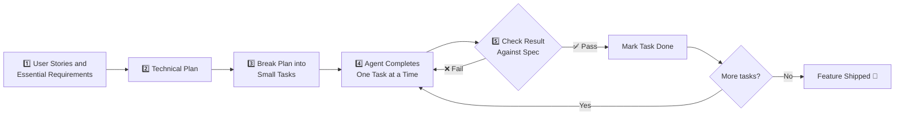
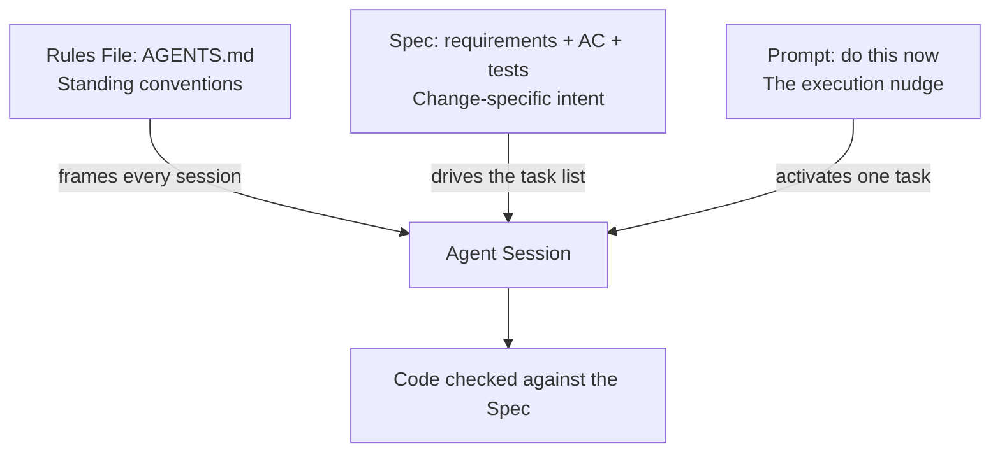

# 📋 30 - Spec-Driven Development

> **Specifications, not one-shot prompts, are now the primary way to direct AI coding agents.**
> Record requirements, limits, and tests before code is written — then let the agent build against them.

**Difficulty:** 🟡 Intermediate · **Reading time:** ~12 minutes

---

## 📖 Table of Contents

- [Why Specs Replaced One-Shot Prompts](#-why-specs-replaced-one-shot-prompts)
- [The Spec-Driven Workflow](#-the-spec-driven-workflow)
- [The Spec Tooling Landscape](#-the-spec-tooling-landscape)
- [Anatomy of a Good Spec](#-anatomy-of-a-good-spec)
- [Worked Example: From Vague Prompt to Compact Spec](#-worked-example-from-vague-prompt-to-compact-spec)
- [Spec vs Prompt vs Rules File](#-spec-vs-prompt-vs-rules-file)
- [Common Failure Modes](#-common-failure-modes)
- [Practical Checklist](#-practical-checklist)
- [Self-Assessment](#-self-assessment)
- [Key Takeaways](#-key-takeaways)
- [Next Steps](#-next-steps)

---

## 🎯 Why Specs Replaced One-Shot Prompts

A **prompt** tells an agent what to do in one exchange. A **specification** records the requirements, limits, and tests the finished work must meet — and stays there while the agent works.

In 2026, specs moved ahead of prompts as the default way to steer AI coding agents. GitHub's Octoverse and the 2026 tooling trends both point the same direction: agents now run for hours across many files, and a single chat message can't carry that much intent. What can: a small, versioned spec sitting next to the code it describes.

| | One-Shot Prompt | Specification |
|---|---|---|
| **Lifespan** | Dies with the chat turn | Lives in the repo, survives sessions |
| **Carries** | An instruction | Requirements + limits + tests |
| **Scope** | This exchange | This feature/change |
| **Reviewable** | ❌ Buried in history | ✅ Diffed, commented, signed off |
| **When written** | During the work | Before coding begins |
| **Failure mode** | Forgotten next turn | Drifts if you don't update it |

### Why This Shift Happened

1. **Agents got longer leashes.** Modern agents run multi-step, multi-file tasks. The longer the run, the more a missing requirement costs to discover at the end.
2. **Context got cheaper to repeat, not to trust.** Re-reading code is cheap; re-deciding what "done" means is not.
3. **Teams needed review artifacts.** AI output that can't be checked against a written definition of done can't be approved by anyone but its author.
4. **Tooling caught up.** GitHub Spec Kit, Kiro, and standards like `AGENTS.md` made writing a spec as easy as writing a prompt.

---

## 🔄 The Spec-Driven Workflow



### The Five Steps

1. **Write user stories and essential requirements** — who needs what, and why.
2. **Turn them into a technical plan** — stack choices, data flow, interfaces.
3. **Break the plan into small tasks** — each task small enough that a wrong turn is cheap to reverse.
4. **Let the agent complete one task at a time** — one focused unit of work per run, not a marathon.
5. **Check each result against the specification** — the spec is the judge, not your memory of the chat.

> **💡 The spec doesn't need to be long.** A compact spec that makes the expected result clear before coding begins beats a 20-page document nobody reads. Aim for something you can review in five minutes.

---

## 🛠️ The Spec Tooling Landscape

### Spec Frameworks & IDEs

| Tool | What It Is | How It Works |
|------|-----------|--------------|
| **[GitHub Spec Kit](https://github.com/github/spec-kit)** | Open-source spec-driven toolkit | CLI that structures `spec → plan → tasks → implement` in your repo |
| **Kiro (AWS)** | Spec-driven IDE | Specs → design → tasks, plus steering files, hooks, and parallel Specs for concurrent workstreams |
| **Spec-driven workflows in agents** | Any capable agent | Feed the spec as the task brief, verify against acceptance criteria |

### Rules & Instructions Files (the Cross-Tool Standard)

| File | Used By | Purpose |
|------|---------|---------|
| **`AGENTS.md`** | Cursor, Codex, Copilot, OpenCode, Cline, Antigravity, Devin Desktop | The cross-tool standard for project instructions — one file, every agent reads it |
| **`CLAUDE.md`** | Claude Code | Claude Code's project instructions file |
| **`.cursor/rules/`** | Cursor | Scoped, reusable rules (per language, per directory) |
| **`.github/copilot-instructions.md`** | GitHub Copilot | Repo-level instructions loaded into Copilot chat |

A minimal `AGENTS.md` that every major agent now understands:

```markdown
# AGENTS.md

## Project
Small-team booking system. Next.js + PostgreSQL + Stripe.

## Rules
- Never commit without running `npm test`
- All times stored in UTC, rendered in user timezone
- Schema changes require a migration file + rollback

## Where things live
- Features: src/features/<name>/
- Specs: specs/<feature>.md  ← read the spec before implementing
```

**Rule of thumb:** `AGENTS.md` carries *standing conventions* (how this repo works). A spec carries *change-specific intent* (what this feature must do). You need both.

---

## 🧩 Anatomy of a Good Spec

| Section | Purpose | Example Line |
|---------|---------|--------------|
| **User stories** | Captures who needs what | "As a client, I can see open time slots" |
| **Acceptance criteria** | The testable definition of done | "A slot cannot be double-booked (enforced in DB)" |
| **Constraints** | Hard limits on the solution | "Next.js + PostgreSQL only; p95 load < 1.5s" |
| **Out of scope** | Defends against scope creep | "Recurring bookings are v2, not this pass" |
| **Test expectations** | How "done" gets proven | "Integration test for the booking race condition" |
| **Performance requirements** | Speed and scale targets | "Search returns in < 200ms for 50K slots" |
| **Security requirements** | Threats the work must not introduce | "No PII in logs; rate-limit booking endpoint" |

### Compact Spec Template

```markdown
# Spec: [Feature Name]

## User Stories
- As a [user], I can [action] so that [benefit]

## Acceptance Criteria
- [ ] [Testable condition 1]
- [ ] [Testable condition 2]

## Constraints
- Stack:
- Performance:
- Security:

## Out of Scope
- [Explicit non-goals]

## Tests
- Unit:
- Integration:
- E2E:
```

---

## ✍️ Worked Example: From Vague Prompt to Compact Spec

### ❌ The Vague Prompt

```
Build me a booking system
```

The agent will guess: which calendar? whose timezone? payments or not? what happens on conflicts? Every guess is a rework ticket later.

### ✅ The Compact Spec

```markdown
# Spec: Small-Team Booking System

## User Stories
- As a client, I can see available time slots so I can pick a time
- As a client, I can book a slot and receive a confirmation email
- As an admin, I can block slots for holidays

## Acceptance Criteria
- [ ] A slot cannot be double-booked (enforced in the database, not just the UI)
- [ ] Confirmation email sent within 60 seconds of a successful booking
- [ ] Cancelling a booking frees the slot immediately (max 10s staleness)
- [ ] All times shown in the client's timezone, stored in UTC

## Constraints
- Stack: Next.js + PostgreSQL + Stripe (no new paid services)
- Performance: p95 page load < 1.5s on a 3G connection
- Security: rate-limit booking endpoint; no PII in logs

## Out of Scope
- Recurring bookings, group bookings, calendar sync (v2)

## Tests
- Unit: slot availability logic
- Integration: double-booking race condition
- E2E: booking happy path + cancellation
```

**Same feature, different outcome.** The prompt produces *something*. The spec produces something you can review, test, and hand to an agent in five separate tasks — each checked against the same acceptance criteria.

---

## ⚖️ Spec vs Prompt vs Rules File

| Dimension | One-Shot Prompt | Rules File (`AGENTS.md`) | Spec |
|-----------|-----------------|--------------------------|------|
| **What it defines** | This one instruction | Standing project conventions | Requirements, limits, tests for a change |
| **Scope** | Single exchange | Whole repo, always loaded | One feature or change |
| **Written** | During the work | Once per project | Before coding begins |
| **Versioned** | ❌ | ✅ | ✅ |
| **Reviewable by a human** | ❌ | Partially | ✅ Fully |
| **Best for** | Quick questions, small edits | Style, structure, commands | New features, refactors, anything multi-file |
| **Typical failure** | Forgotten next turn | Ignored when too long | Drifts when requirements change |



Use all three: **rules** for how the repo works, a **spec** for what this change must achieve, and **prompts** to drive each individual task.

---

## ⚠️ Common Failure Modes

### 1. The Spec Is Too Vague

❌ `The booking system should be fast and secure.`
✅ `p95 load < 1.5s; booking endpoint rate-limited to 10 req/min; no PII in logs.`

If an acceptance criterion can't be checked by a test or a stopwatch, it isn't a criterion — it's a wish.

### 2. The Spec Drifts

Requirements change in chat, but the spec file doesn't. Now the code matches yesterday's conversation and nobody knows what's true.

**Fix:** the spec is the source of truth. Every requirement change lands in the **same PR** as the code that implements it. If the spec and the code disagree, the spec wins — until it's updated.

### 3. Ignoring the Spec During Review

The agent finished, the code looks plausible, the tests pass — but nobody re-opened the spec.

**Fix:** review by walking the acceptance criteria one by one:

```markdown
## Spec Review — booking system
- [x] No double-booking (DB constraint + race test)
- [x] Email within 60s (verified: p99 = 41s)
- [x] Cancel frees slot (verified: 3s staleness)
- [ ] Timezone rendering — ❌ shows UTC for US clients → REJECT
```

---

## ✅ Practical Checklist

Before you hand work to an agent:

- [ ] **Every user story** has at least one testable acceptance criterion
- [ ] **Out-of-scope list** exists (scope creep defense)
- [ ] **Constraints** are named: stack, performance, security, budget
- [ ] The spec is **small enough to read in five minutes**
- [ ] Tasks derived from the spec are **small** (one focused agent run each)
- [ ] Each completed task is **checked against the spec**, not just eyeballed
- [ ] Requirement changes update the **spec in the same PR**
- [ ] Standing conventions live in **`AGENTS.md`**, not repeated in every prompt

---

## 📊 Self-Assessment

**Score yourself (1-5) on each:**

| Skill | Rating | Description |
|-------|--------|-------------|
| **Spec Writing** | _/5 | Can you turn a vague idea into testable criteria? |
| **Task Decomposition** | _/5 | Can you slice a plan into small, reversible tasks? |
| **Review Against Spec** | _/5 | Do you verify output against written criteria? |
| **Drift Control** | _/5 | Does your spec stay in sync with the code? |
| **Tooling** | _/5 | Do you use AGENTS.md / Spec Kit / steering files? |

**Scoring:**
- **5-10**: Beginner — start with the compact spec template above, one feature at a time
- **11-17**: Intermediate — adopt a full `spec → plan → tasks` loop and add AGENTS.md
- **18-25**: Advanced — run parallel specs, review by criteria, teach this to your team

---

## 📌 Key Takeaways

1. **Prompts are ephemeral; specs are durable.** Write the definition of down *before* the agent starts.
2. **Length is not the goal — clarity is.** A five-minute spec with testable acceptance criteria beats a novel.
3. **Break work small, verify often.** One task per agent run, checked against the spec each time.
4. **Rules files ≠ specs.** `AGENTS.md` says how the repo works; a spec says what this change must do.
5. **The spec is the source of truth.** Update it in the same PR or watch it drift.

---

## 🎯 Next Steps

Now that you understand spec-driven development:

1. ✅ **Refine**: Rework your next feature idea into the compact spec template above
2. 📖 **Master prompting**: Revisit [07 - Prompt Engineering](../07-prompt-engineering/) — specs and prompts work together
3. 🔧 **Go production**: Apply specs inside [17 - Real-World Workflows](../17-real-world-workflows/) (PRs, reviews, standups)
4. 🤖 **Scale up**: Pair specs with [22 - AI Agents](../22-ai-agents/) for longer autonomous runs

---

> **💡 Pro Tip:** Don't wait for the "perfect" spec. Write a compact one, start the first task, and refine the spec in the same PR as you learn. A good spec is edited, not authored in one heroic sitting.

---

<div align="center">

**Ready to spec before you vibe?**  
➡️ [Next: AI Cost Engineering](../31-ai-cost-engineering/) ⬅️

[⬆️ Back to Introduction](../00-introduction/) | [Prompt Engineering](../07-prompt-engineering/)

Made with ❤️ by the Vibe Coding Community

</div>
