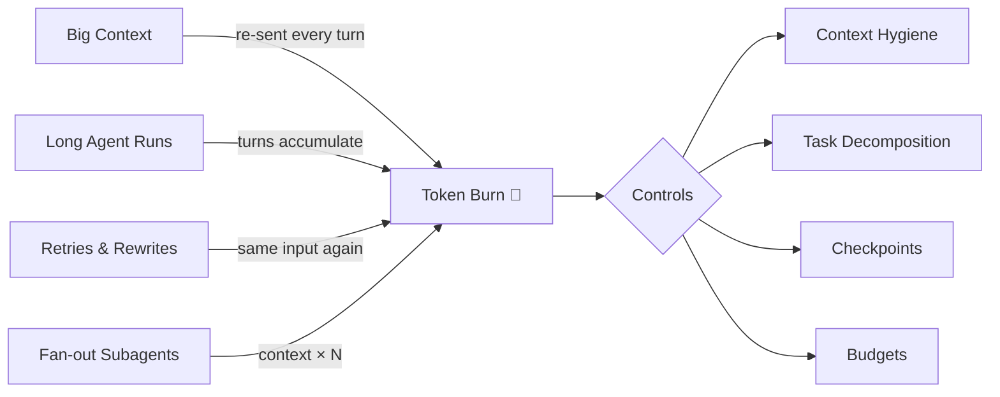
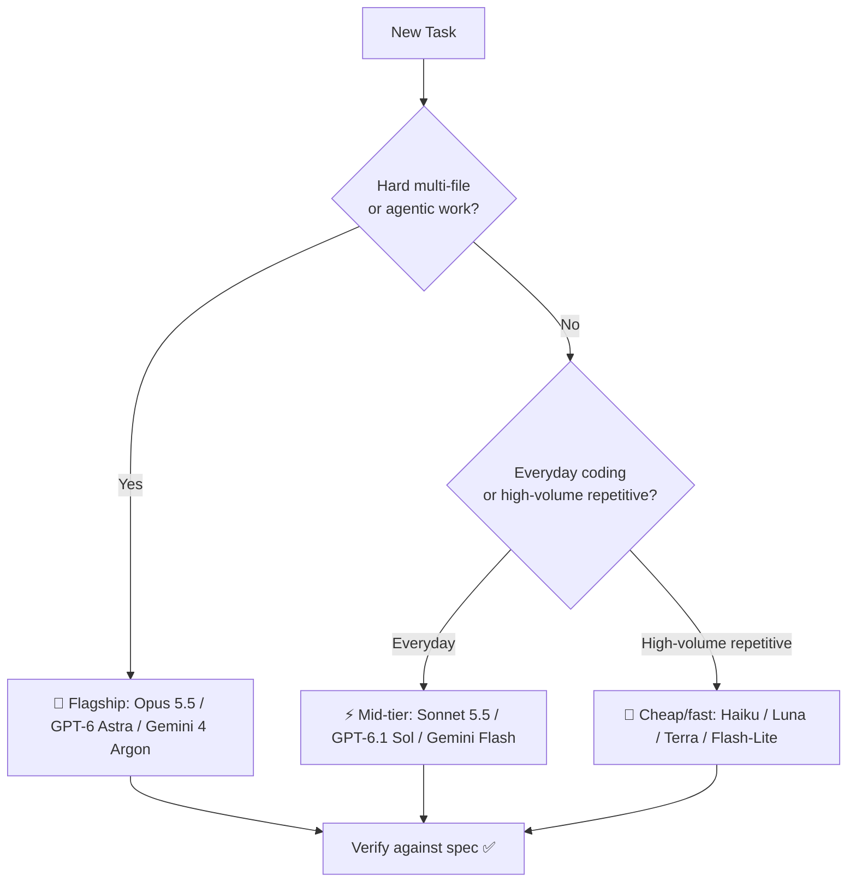

# 💰 31 - AI Cost Engineering

> **Token bills are the new cloud bills — manage them like an engineer, not a gambler.**
> Tokens, model routing, budgets, and the true cost of AI slop for AI-assisted development.

**Difficulty:** 🟡 Intermediate · **Reading time:** ~14 minutes

---

## 📖 Table of Contents

- [Why Cost Engineering Matters Now](#-why-cost-engineering-matters-now)
- [How Tokens & Pricing Work](#-how-tokens--pricing-work)
- [What Drives Your Bill](#-what-drives-your-bill)
- [Model Routing Strategy](#-model-routing-strategy)
- [Concrete Cost Controls](#-concrete-cost-controls)
- [Real-World Monthly Cost Examples](#-real-world-monthly-cost-examples)
- [Monitoring & Estimation](#-monitoring--estimation)
- [The Economics of AI Slop](#-the-economics-of-ai-slop)
- [Practical Checklist](#-practical-checklist)
- [Self-Assessment](#-self-assessment)
- [Key Takeaways](#-key-takeaways)
- [Next Steps](#-next-steps)

---

## 📈 Why Cost Engineering Matters Now

The industry shifted from **flat seat subscriptions** to **consumption/token pricing**. Under flat pricing, a bad session was a bad day. Under token pricing, it's an invoice line item.

In **June 2026, Gartner warned** that token-based pricing creates unpredictable costs and forecast that **AI coding costs could exceed the average developer's salary by 2028**. That forecast only comes true for teams that treat tokens as an unbounded resource.

The uncomfortable part: **failed attempts now show up on the invoice.**

| Old World (Flat Seats) | New World (Consumption) |
|------------------------|-------------------------|
| Long session = same $20/mo | Long session = more tokens = more money |
| Re-prompting is "free" | Every retry is a fresh input charge |
| One context, one price | Large project context re-sent every turn |
| Cost visible monthly | Cost visible per feature, per agent run |
| Waste is invisible | Waste is measurable — and fixable |

---

## 🪙 How Tokens & Pricing Work

A **token** is the unit models bill for — roughly ¾ of an English word, or ~4 characters of code. Every API call bills four different kinds of tokens at four different rates:

| Token Type | What It Is | Relative Cost |
|------------|-----------|---------------|
| **Input** | Fresh text you send: your prompt, new code, new context | 1× (baseline) |
| **Output** | What the model generates: code, explanations | Typically 5× input |
| **Cache write** | First time a stable prefix gets cached | Slightly above input (one-time) |
| **Cache read** | Re-reading already-cached context on later turns | **~10% of input** — dramatically cheaper |

### Why Caching Changes Everything

Agents resend the conversation every turn. Without caching, a 100K-token context costs full input price × every turn. With caching, turns 2..N re-read that context at a fraction of the price — which is why **cache-friendly prompt structure** (below) is a real cost control, not a micro-optimization.

### Worked Example: One Long Session

```
Scenario: 2-hour agent session on Claude Sonnet 5.5
Pricing: $2 input / $10 output per 1M tokens, cache reads ≈ $0.20/1M

Fresh input:    300K × $2/1M     = $0.60
Cache reads:  1,200K × $0.20/1M  = $0.24   ← re-reading context is ~10× cheaper
Output:        120K × $10/1M     = $1.20
────────────────────────────────────────────
Session total ≈ $2.04

× 20 working days ≈ $41/month — from ONE long session on ONE model
```

---

## 🔥 What Drives Your Bill

| Driver | Why It Burns Tokens | Control |
|--------|--------------------|---------|
| **Context window size** | Every turn re-sends the whole conversation | Compact summaries, agent ignore files, fresh sessions |
| **Agent run length** | Long autonomous runs accumulate turns | Timebox runs; checkpoint often |
| **Repeated retries** | The same failed fix, re-explained N times | Diagnose before re-prompting |
| **Multi-file refactors** | Whole files re-read on every turn | Split into per-file tasks |
| **Subagent fan-out** | Each subagent re-reads its own context | Limit fan-out; pass summaries, not raw history |
| **Image/large-file attachments** | Images and logs tokenized at high rates | Attach excerpts, not whole files |



---

## 🧭 Model Routing Strategy

**Route by task, not by habit.** The flagship model on every trivial edit is the AI equivalent of driving a semi to the grocery store.

| Tier | Models | Use For |
|------|--------|---------|
| 🚩 **Flagship** | Claude Opus 5.5, GPT-6 Astra, Gemini 4 Argon | Hard multi-file/agentic work: architecture, tricky debugging, cross-cutting refactors |
| ⚡ **Mid-tier** | Claude Sonnet 5.5, GPT-6.1 Sol, Gemini Flash | Everyday coding: features, tests, most reviews and explanations |
| 🌱 **Cheap/fast** | Haiku, Luna, Terra, Flash-Lite | High-volume repetitive steps: renaming, formatting, classification, log triage |



**The upgrade rule:** start on the tier you *think* fits, and escalate only when the output proves the task was harder than it looked. Escalating mid-task costs one retry; defaulting to flagship costs every task.

---

## 🎛️ Concrete Cost Controls

### 1. Context Hygiene

- **Compact summaries:** when a session gets long, replace raw history with a short summary of decisions made and files touched.
- **Agent ignore files:** add a `.gitignore`-like ignore list (`.aiignore`, `AGENTS.md` exclusions) so agents don't load `node_modules/`, build output, lockfiles, or logs.
- **Clear stale context:** start a fresh session when the topic changes — carrying yesterday's debugging into today's feature work is pure token waste.

### 2. Task Decomposition

Big retries are the #1 budget killer. Small tasks fail small:

```
❌ "Refactor the entire billing module"        → 40 minutes, fails, 40 minutes wasted
✅ "Extract the invoice calculation into its own function" → 5 minutes, verifiable, done
```

### 3. Checkpoints

Commit at every verified step. A mistake that costs one revert costs an entire re-run without them — and re-runs re-read the whole context at full input price.

```bash
git add -A && git commit -m "checkpoint: slot availability logic passing"
```

### 4. Spending Limits & Budgets

Configure limits that actually **stop** excessive token use rather than just displaying it:

```yaml
# Illustrative budget config — most agents/platforms support something like this
budgets:
  daily_usd: 10
  per_feature_usd: 25
  action_on_exceeded: pause-and-notify   # not "keep going and warn later"
```

### 5. Cache-Friendly Prompt Structure

Put the **stable content first, volatile content last** so the cached prefix stays valid across turns:

```
✅ Cache-friendly ordering:
   [system prompt + rules + project context] ← stable, gets cached
   [spec for this feature]                   ← stable while working on it
   [this turn's question]                    ← volatile, goes at the end

❌ Cache-hostile ordering:
   [this turn's question] ... huge context ...
   [rules] ← rules keep moving, cache never hits
```

### 6. Choose Agents With Usage-Based Guards

Prefer agents that ship with per-run token caps, budget warnings, and permission gates before expensive operations (see [22 - AI Agents](../22-ai-agents/)).

---

## 💸 Real-World Monthly Cost Examples

### Subscription Plans (typical 2026 pricing)

| Plan | Price |
|------|-------|
| Claude Pro | $20/mo |
| Claude Max | $100–200/mo |
| Cursor Pro | $20/mo |
| ChatGPT Plus | $20/mo |
| GitHub Copilot | $10–39/mo |

### Rough Monthly Totals by Persona

| Persona | Typical Setup | Rough Monthly Cost |
|---------|---------------|--------------------|
| **Solo builder** | Claude Pro or ChatGPT Plus + Cursor Pro | **$40–60/mo** |
| **Professional** | Claude Max (20x) + Cursor Pro + Copilot | **$100–250/mo** |
| **Heavy agent user** | Claude Max (100x) + API usage for subagents/fan-out | **$300–800+/mo** |

### API Usage Reference (per 1M tokens)

| Model | Input | Output | Tier |
|-------|-------|--------|------|
| Claude Opus 5.5 | $4 | $20 | 🚩 Flagship |
| Claude Sonnet 5.5 | $2 | $10 | ⚡ Mid-tier |
| GPT-6.1 Terra | $2 | $10 | ⚡ Mid-tier |
| Kimi K3 | $3 | $15 | ⚡ Mid/upper |
| GLM-5.3 | $1.40 | $4.40 | 🌱 Budget |
| Haiku 5.5 | $0.10 | $0.50 | 🌱 Cheap/fast |
| DeepSeek V4.1 Flash | $0.15 | $0.60 | 🌱 Cheap/fast |

> The spread between a flagship output token ($20/1M) and a cheap-tier input token ($0.10/1M) is **200×**. Routing decisions dominate every other cost control.

---

## 📊 Monitoring & Estimation

You can't control what you don't measure. Track spend at the level you make decisions:

| Metric | How to Track | When to Act |
|--------|-------------|-------------|
| **Spend per project/feature** | Tag sessions or log API usage per workspace | Any feature costing more than its rough value |
| **Cost per shipped feature** | Total tokens for feature ÷ features shipped | Trend rising while velocity flat |
| **Retry rate** | Failed attempts ÷ total tasks | > 30% → decompose tasks smaller |
| **Cache hit rate** | Cache-read tokens ÷ total input tokens | Low → reorder prompts (stable first) |
| **Model mix** | % of tokens on flagship tier | > 50% → audit what's actually being routed |

A lightweight cost log is enough to start:

```markdown
| Date | Feature | Model | Tokens (in/out) | Cost | Shipped? |
|------|---------|-------|-----------------|------|----------|
| 2026-11-03 | Booking search | Sonnet 5.5 | 820K / 95K | $2.13 | ✅ |
| 2026-11-03 | Payments refactor | Opus 5.5 | 1.4M / 210K | $9.80 | ✅ |
| 2026-11-04 | Log triage (x40) | Haiku 5.5 | 2.1M / 60K | $0.24 | ✅ |
```

**When to switch models:**
- **Down-tier** when output is mechanical or the task is unchanged from yesterday — mid-tier or cheap tier will pass review.
- **Up-tier** when the same task has failed twice on a lower tier — one flagship success is cheaper than five mid-tier retries.
- **Switch providers** when a cheap open-weights model (DeepSeek, GLM, Kimi) handles a recurring workload at a fraction of the cost with acceptable quality.

---

## 🧮 The Economics of AI Slop

**Cheaper isn't cheaper if rework multiplies.** A $0.10/1M model that produces copy-pasted, un-refactored code generates downstream costs that dwarf the token savings.

GitClear's analysis of AI-era code found:

| Metric | Earlier Baseline | 2026 Finding |
|--------|------------------|--------------|
| **Copy-pasted lines** | 8.3% of changed lines | **12.3%** — duplicated, not reasoned |
| **Refactoring** | ~25% of changed lines | **Under 10%** — code accumulates instead of improving |

That's the slop tax: less structural improvement, more duplication — which means the *next* feature costs more tokens to understand and more hours to change.

```
True cost of a feature =
    tokens spent generating it
  + tokens spent re-reading bloated context it created
  + rework when duplication breaks invariants
  + maintenance for every future developer (human or agent)
```

**Tie cost to quality:** review cost per *shipped, maintainable* feature — not cost per token. A feature that costs $8 in flagship tokens and passes review once beats a $1 feature that needs three rework rounds and leaves duplicated logic behind. This is where cost engineering meets [17 - Real-World Workflows](../17-real-world-workflows/) quality gates.

---

## ✅ Practical Checklist

- [ ] You know your **monthly AI spend** across every tool and API
- [ ] Spend is tracked **per project/feature**, not just per tool
- [ ] **Flagship models reserved** for hard tasks; mid-tier is the default
- [ ] **Context hygiene** in place: summaries, agent ignore files, fresh sessions
- [ ] Tasks are **decomposed small** so failures don't burn full context
- [ ] **Checkpoints** (git) at every verified step
- [ ] **Budgets configured** to stop runaway usage, not merely warn about it
- [ ] Prompts structured **cache-friendly** (stable prefix first)
- [ ] You estimate **cost per shipped feature** and check quality (no slop)

---

## 📊 Self-Assessment

**Score yourself (1-5) on each:**

| Skill | Rating | Description |
|-------|--------|-------------|
| **Pricing Literacy** | _/5 | Do you know input/output/cache rates for your models? |
| **Model Routing** | _/5 | Do you pick tiers by task instead of by habit? |
| **Context Hygiene** | _/5 | Are stale contexts and junk files out of the window? |
| **Budgeting** | _/5 | Do limits exist that actually stop spending? |
| **Cost-per-Feature** | _/5 | Can you say what your last feature cost? |

**Scoring:**
- **5-10**: Beginner — turn on spend tracking and set one budget this week
- **11-17**: Intermediate — add routing rules and start estimating cost per feature
- **18-25**: Advanced — optimize cache hit rates, watch quality metrics, tune your whole fleet

---

## 📌 Key Takeaways

1. **Consumption pricing made every session billable** — long runs, retries, and fat context are now line items, not background noise.
2. **Cache reads are dramatically cheaper** — structure prompts stable-first and re-reading context stops dominating your bill.
3. **Route by task, not habit** — 200× price spreads exist between tiers; flagship only for genuinely hard work.
4. **Decompose, checkpoint, budget** — the three controls that stop a bad day from becoming a bad invoice.
5. **Cheap tokens + slop = expensive software** — GitClear's copy-paste/refactor shift shows why cost must be tied to quality, not just to the meter.

---

## 🎯 Next Steps

Now that you can engineer AI costs:

1. ✅ **Track**: Turn on usage dashboards and start a cost log for your current project
2. 💰 **Monetize**: Apply cost awareness to pricing and margins in [18 - Monetization](../18-monetization/)
3. 💼 **Bill clients**: Fold token costs into your rates in [19 - Freelancing](../19-freelancing/)
4. 🧠 **Choose models**: Go deeper on tiers and trade-offs in [04 - AI Models](../04-ai-models/)

---

> **💡 Pro Tip:** Review your AI spend the way you review your cloud bill — weekly, per project, with one question: "What would this feature have cost with better routing, smaller context, and no rework?" The answer is almost always *less than you're paying now*.

---

<div align="center">

**Keep your costs — and your vibes — in check!**  
➡️ [Back: Spec-Driven Development](../30-spec-driven-development/) ⬅️

[⬆️ Back to Introduction](../00-introduction/) | [Monetization](../18-monetization/)

Made with ❤️ by the Vibe Coding Community

</div>
