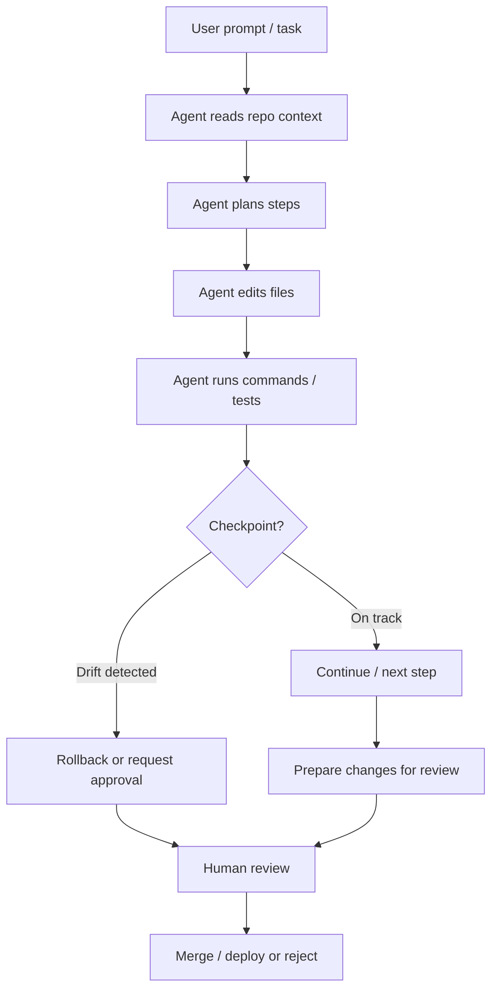

# 🛡️ 32 - AI Agent Safety & Governance

> **Autonomous agents can read your repo, edit files, run commands, and open pull requests without you watching every step. Safety is not optional — it is the infrastructure that makes agentic development viable at scale.**
> **Governance turns "the AI built it" from a liability into an auditable, owned process.**

**Difficulty:** 🟡 Intermediate · **Reading time:** ~14 minutes

---

## 📖 Table of Contents

- [Why Agent Safety Is Different in 2026](#-why-agent-safety-is-different-in-2026)
- [The Anatomy of an Agent Run](#-the-anatomy-of-an-agent-run)
- [Long-Running Agent Safety Controls](#-long-running-agent-safety-controls)
- [Agent Permissions & Least Privilege](#-agent-permissions--least-privilege)
- [Credential & Secret Hygiene for Agents](#-credential--secret-hygiene-for-agents)
- [MCP Server Security](#-mcp-server-security)
- [Approval Gates & Human-in-the-Loop](#-approval-gates--human-in-the-loop)
- [Rollback & Incident Response for Agent Changes](#-rollback--incident-response-for-agent-changes)
- [Practical Checklist](#-practical-checklist)
- [Self-Assessment](#-self-assessment)
- [Key Takeaways](#-key-takeaways)
- [Next Steps](#-next-steps)

---

## 🎯 Why Agent Safety Is Different in 2026

Autocomplete suggests the next line; **agents act**. A coding agent can:

- Inspect your entire repository and modify dozens of files
- Run shell commands, install packages, and start services
- Execute tests, linters, and build steps
- Open pull requests and merge code

That power is exactly what makes agents valuable — and exactly what makes them dangerous when ungoverned. The shift from "AI suggests" to "AI does" means a single misconfigured agent session can introduce vulnerabilities, leak credentials, or corrupt production data faster than you can review it.

**The governing principle:** agents are **capable but not accountable**. You remain accountable for everything an agent does in your name.

---

## 🧬 The Anatomy of an Agent Run

Every arrow in this diagram is a safety boundary. Your job is to define and enforce the gates at **F**, **J**, and **K**.

---

## 🛑 Long-Running Agent Safety Controls

Agents can run for minutes or hours. A wrong assumption five minutes into a two-hour task wastes tokens and touches many files. The 2026 consensus controls:

| Control | What it does | Example |
|---------|--------------|---------|
| **Checkpoints** | Reveal whether work is still on track at defined intervals | "After each file edit, run the test suite and report pass/fail" |
| **Spending limits** | Stop excessive token use before it becomes a bill shock | Max $50 per agent session; hard stop at 1M input tokens |
| **Isolated environments** | Protect production systems from agent experiments | Docker container or ephemeral VM with no production network access |
| **Reversible changes** | Every agent edit must be rollback-able | All work on a git branch; `git revert` or `git reset` as escape hatch |
| **Approval before sensitive actions** | Human sign-off for irreversible or outward-facing steps | Deploy, database migration, credential access, external API calls |

**Rule of thumb:** if an agent action cannot be undone in one command, it requires human approval before it runs.

---

## 🔐 Agent Permissions & Least Privilege

Give agents the minimum access they need to complete the task — nothing more.

| Permission level | When to grant | Example scope |
|------------------|---------------|---------------|
| **Read-only** | Code explanation, architecture review | `git log`, file listing, read source files |
| **Write (branch-scoped)** | Feature implementation, refactoring | Edit files on a feature branch only |
| **Command execution** | Running tests, linters, builds | `npm test`, `pytest`, `cargo build` in sandbox |
| **Network outbound** | Installing packages, fetching docs | Registry access only; no production endpoints |
| **Deploy / production** | **Never by default** | Requires explicit human approval per deployment |

**Never** grant an agent:
- Write access to `main`/`master` without a PR and human review
- Access to production databases or credentials
- Unrestricted outbound network access to internal services
- The ability to modify its own permission configuration

---

## 🗝️ Credential & Secret Hygiene for Agents

Agents that can read your codebase can also read your secrets if they are committed or in environment files.

- **Never paste secrets into agent context.** API keys, database passwords, and signing keys do not belong in a prompt.
- **Use secret managers** (AWS Secrets Manager, HashiCorp Vault, 1Password CLI) and have the agent reference secret *names*, never values.
- **Add secrets to `.gitignore`** and repository secret-scanning (GitHub secret scanning, GitGuardian, TruffleHog).
- **Rotate any credential an agent may have seen.** If an agent session had access to a key, treat it as compromised.
- **Use agent-specific credentials** where possible — scoped API keys with limited permissions rather than your personal account.

---

## 🔌 MCP Server Security

The Model Context Protocol (MCP) lets agents connect to tools and data sources. Every MCP server you add is a new attack surface.

| Risk | Mitigation |
|------|------------|
| Malicious MCP server exfiltrates code | Only run MCP servers from trusted publishers; review server code before installing |
| MCP server over-permissioned | Configure each MCP server with the narrowest tool set needed |
| Agent calls MCP tool with sensitive data | Audit MCP tool invocation logs; avoid passing PII or credentials as tool arguments |
| MCP server compromised at runtime | Run MCP servers in isolated containers with no production network access |

**Treat every MCP server as untrusted code running with your permissions.**

---

## 🚦 Approval Gates & Human-in-the-Loop

Define explicit gates where an agent must stop and wait for you:

| Gate | Trigger | Who approves |
|------|---------|--------------|
| **Pre-task** | Agent starts a new multi-file task | Developer |
| **Mid-task checkpoint** | Checkpoint detects drift or test failure | Developer (or automated rule) |
| **Sensitive action** | Deploy, migration, credential access, external call | Developer + security review if production |
| **Pre-merge** | Agent-prepared PR ready for review | Human code reviewer (not the agent) |

**Pattern:** The agent proposes; the human disposes. Agents prepare, humans decide.

---

## ↩️ Rollback & Incident Response for Agent Changes

When an agent causes a problem, you need to recover fast:

1. **Identify** — Find the agent session and commit range (look for AI-generated commit messages, agent-authored PRs).
2. **Contain** — Revert the agent's branch; revoke any credentials it may have accessed.
3. **Remediate** — Fix the underlying issue (bad prompt, missing guardrail, over-permissioned agent).
4. **Review** — Conduct a blameless postmortem: what guardrail failed, and how do we prevent recurrence?
5. **Update** — Tighten agent permissions, add checkpoints, or revise the approval policy.

**Keep an agent audit log:** who started the session, which model was used, what files were touched, and who approved each gate. This is your compliance trail.

---

## ✅ Practical Checklist

- [ ] Agents run on feature branches only — never directly on `main`
- [ ] Every agent session has a defined spending/token limit
- [ ] Agent work happens in an isolated/sandboxed environment
- [ ] No secrets or credentials are pasted into agent context
- [ ] MCP servers are from trusted sources and minimally permissioned
- [ ] Human approval required before deploy, migration, or external API calls
- [ ] Every agent-produced change has a human reviewer before merge
- [ ] Agent audit log is kept (session, model, files touched, approvals)
- [ ] Rollback procedure is tested (`git revert` / branch deletion)
- [ ] Credentials accessed by an agent are rotated after the session

---

## 📊 Self-Assessment

Rate your current agent setup (1 = weak, 5 = strong):

| Area | Your score /5 | What "5" looks like |
|------|:-------------:|---------------------|
| Agent branch isolation | _/5 | All agent work on feature branches, PR-required |
| Spending & token limits | _/5 | Hard caps enforced per session and per month |
| Secret hygiene | _/5 | No secrets in prompts; secret manager in use |
| MCP security | _/5 | Trusted servers only, least-privilege tool sets |
| Approval gates | _/5 | Human sign-off for all sensitive actions |
| Rollback readiness | _/5 | Can revert any agent change in one command |
| Audit trail | _/5 | Full session log with model, files, approvals |

**Scoring:** 30–35 = production-ready · 20–29 = tighten guardrails · below 20 = do not run agents on sensitive code yet

---

## 🔑 Key Takeaways

- **Agents act; humans are accountable.** Governance is what makes autonomy safe.
- **Five safety controls:** checkpoints, spend limits, isolation, reversibility, and approval gates.
- **Least privilege applies to agents too** — read-only by default, write only on branches, never production by default.
- **MCP servers are untrusted code** — audit them like any dependency.
- **The agent proposes; the human disposes.** No merge without human review.

---

## 🚀 Next Steps

- **Read section [33 — Enterprise Governance & Production Reliability](./33-enterprise-governance/)** for org-wide guardrails, AI slop prevention, and compliance frameworks.
- **Read section [31 — AI Cost Engineering](./31-ai-cost-engineering/)** to pair safety with token budgeting.
- **Read section [22 — AI Agents](./22-ai-agents/)** for agent architecture patterns to build on.

---

*Last updated: November 2026*

