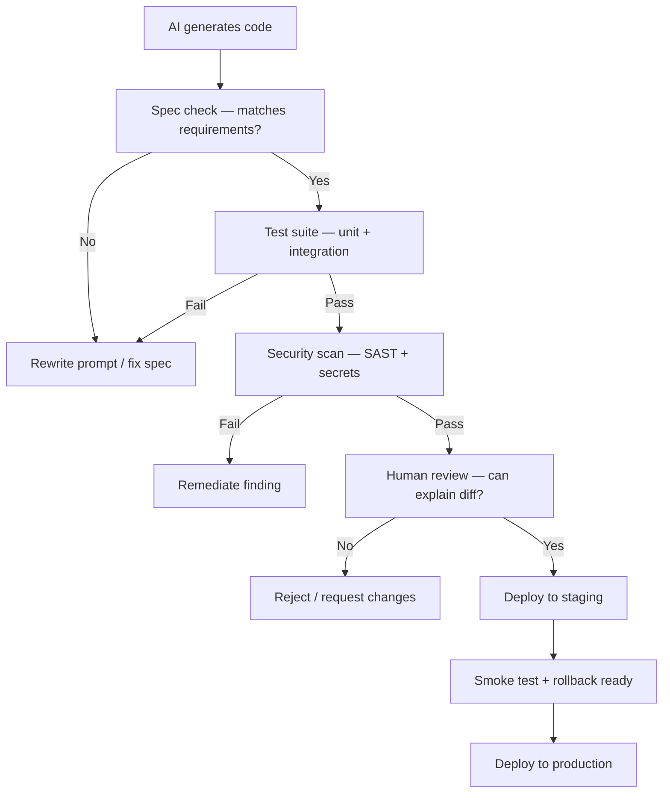

# 🏢 33 - Enterprise Governance & Production Reliability

> **When the majority of code is machine-generated, "who is responsible?" becomes the most important question in your organization. Governance is how you answer it — before an audit or an incident forces your hand.**
> **Production reliability for AI-built apps requires guardrails, ownership, and verification — not just generation speed.**

**Difficulty:** 🟡 Intermediate · **Reading time:** ~14 minutes

---

## 📖 Table of Contents

- [From Novelty to Production](#-from-novelty-to-production)
- [AI Slop: What It Is and How to Prevent It](#-ai-slop-what-it-is-and-how-to-prevent-it)
- [Governance for Machine-Generated Codebases](#-governance-for-machine-generated-codebases)
- [Enterprise Guardrails](#-enterprise-guardrails)
- [Compliance Frameworks for AI-Generated Software](#-compliance-frameworks-for-ai-generated-software)
- [Production Reliability Patterns for AI-Built Apps](#-production-reliability-patterns-for-ai-built-apps)
- [Ownership & Maintenance Budgeting](#-ownership--maintenance-budgeting)
- [Practical Checklist](#-practical-checklist)
- [Self-Assessment](#-self-assessment)
- [Key Takeaways](#-key-takeaways)
- [Next Steps](#-next-steps)

---

## 📈 From Novelty to Production

Vibe coding began as a way to prototype quickly. In 2026 it has crossed into production:

- **Majority of code is machine-generated** (per Oracle's software engineering SVP, 2026) — and that code still has to be maintained, governed, and understood by people.
- **~63% of vibe-coding platform users are not developers** — the growth is coming from new entrants, not engineers replacing themselves.
- **96% of developers do not fully trust AI-generated code** (Sonar 2026); only 48% always check it before committing.

Creating an application is not the same as creating a **reliable** one. AI-generated software can look impressive while containing errors that inexperienced users struggle to identify — a budgeting app that miscalculates totals, a booking system that accepts conflicting reservations, or a site that exposes personal data.

**Governance closes the gap between "it runs" and "it is safe to run."**

---

## 🧽 AI Slop: What It Is and How to Prevent It

**AI slop** is low-value, machine-generated code that works well enough to ship but is hard to understand, test, or maintain. It is the technical debt of the AI era, generated at LLM speed.

### Symptoms of AI slop

| Symptom | Why it matters |
|---------|----------------|
| Code that "looks correct but is unreliable" | Passes a quick glance but fails under load or edge cases (Sonar: 61% of devs see this) |
| Copy-pasted blocks instead of refactored code | GitClear: copy-pasted lines rose 8.3% → 12.3%; refactoring fell ~25% → under 10% of changed lines |
| Massive, undifferentiated diffs | Hundreds of files changed in one PR, impossible to review meaningfully |
| No tests or thin tests | Generated code ships without coverage; bugs surface in production |
| No human understanding | The original prompter cannot explain how a module works |

### Prevention tactics

- **Specs before code** — write a compact specification (section 30) so generation is bounded and verifiable.
- **Small, reviewable PRs** — require agents to break work into small, single-purpose pull requests.
- **Tests first** — require test coverage before a PR can merge; AI writes tests alongside implementation.
- **Review every change** — no "trust the agent" merges. A human must be able to explain each diff.
- **Refactor aggressively** — treat AI output as a first draft, not a final product. Refactor duplicated or convoluted code immediately.

---

## 🏛️ Governance for Machine-Generated Codebases

When most of your code is generated, governance shifts from "review every line" to "manage every intent."

### The compact-definition principle

A compact, intent-level definition (a spec, a schema, a rules file) is easier to audit than sprawling generated code. This is the logic behind approaches like Oracle's APEXlang — publish the grammar, skills, and documentation so both humans and agents can work from a shared, reviewable source of truth.

**Apply it in your org:**
- Store `AGENTS.md` and `CLAUDE.md` in version control as the authoritative agent instructions.
- Treat specs (section 30) as first-class artifacts — review them like design docs.
- Version-control every rules file (`.cursor/rules/`, `.github/copilot-instructions.md`, `.kiro/steering/`).
- Require that any agent behavior change starts with a spec change, not a prompt change.

### Ownership model

Assign a **human owner** to every AI-generated component:

| Component | Owner responsibility |
|-----------|---------------------|
| AI-generated service | Can explain architecture, debug incidents, plan migration |
| AI-generated test suite | Maintains coverage, updates tests as behavior changes |
| AI-generated infrastructure | Manages IaC, knows rollback procedure |
| AI-generated security config | Responds to findings, rotates credentials |

**If no human can own it, do not ship it.**

---

## 🛡️ Enterprise Guardrails

These are the 2026 consensus practices for safe enterprise adoption of AI coding:

| Guardrail | Implementation |
|-----------|----------------|
| **Automated scanning on every PR** | SAST/DAST, secret scanning, dependency scanning; block merge on critical findings |
| **Minimal agent permissions** | Least privilege; sandboxed environments; no production write by default |
| **Protected credentials** | Secret scanning, no keys in prompts, rotate after agent access |
| **Human approval for production changes** | No agent-triggered deployment without explicit human sign-off |
| **Threat-model-driven tests** | Tests written against likely security threats, not just functional paths |
| **Code review requirements** | Every AI-generated PR needs a human reviewer who can explain the diff |
| **Agent audit logging** | Record session, model, files touched, approvals — retained for compliance |
| **Cost & token guardrails** | Spending limits per agent session; alerts at budget thresholds (section 31) |

> Gartner (November 2026): enterprise architecture and software engineering leaders must establish guardrails, governance, and support models that enable safe adoption of AI-assisted development — citizen developers often get trapped in prompting/troubleshooting/rework cycles without them.

---

## 📋 Compliance Frameworks for AI-Generated Software

AI-generated code does not exempt you from compliance. If anything, it increases the burden of proof.

| Framework | Relevance to AI-generated code |
|-----------|-------------------------------|
| **SOC 2 / ISO 27001** | Change management, access control, audit trails must cover agent actions |
| **GDPR / CCPA** | AI must not process or leak personal data; document how agents handle PII |
| **HIPAA** | Healthcare data requires strict access controls — agents must never see PHI unencrypted |
| **PCI DSS** | Payment data handling by AI-generated code must be reviewed and tested |
| **AI Act (EU)** | Disclose AI use in software development where required; document high-risk systems |

### What to document

- Which models and agents are used, and for what tasks
- How code is reviewed and by whom
- How secrets and credentials are protected from agents
- How incidents involving AI-generated code are handled
- Audit logs of agent sessions, retained per your retention policy

---

## 🚀 Production Reliability Patterns for AI-Built Apps

Reliability is built in, not added after generation.

### 1. Verification before deployment

### 2. Testing patterns

- **Property-based tests** — AI struggles with edge cases; property-based testing finds them systematically.
- **Contract tests** — verify AI-generated APIs still honor their contracts across changes.
- **Chaos tests for AI** — intentionally break generated code to confirm monitoring catches it.

### 3. Monitoring & observability

- Instrument AI-generated code at least as thoroughly as human-written code.
- Alert on error rates, latency, and unusual traffic patterns in AI-built services.
- Track "AI attribution" — tag metrics by code origin (human vs AI) so you can correlate reliability with authorship.

### 4. Rollback readiness

- Every deployment of AI-generated code must be reversible in one command.
- Feature flags on AI-built features so you can disable without redeploying.
- Canary deployments for AI-generated changes — roll out to 5% first, watch metrics.

---

## 💰 Ownership & Maintenance Budgeting

AI makes generation cheap but does not eliminate maintenance cost.

- **Budget maintenance time** for every AI-generated component — estimate 2–3× the generation time for review, testing, and upkeep.
- **Track cost per shipped feature**, not just per prompt (section 31). Gartner warns AI coding costs could exceed the average developer's salary by 2028.
- **Retire or refactor** AI-generated code that becomes too costly to maintain — do not let slop accumulate.
- **Assign maintenance owners** at the time of generation, not after an incident.

---

## ✅ Practical Checklist

- [ ] Every AI-generated component has a named human owner
- [ ] Specs (AGENTS.md, CLAUDE.md, rules files) are version-controlled and reviewed
- [ ] Automated security scanning runs on every AI-generated PR
- [ ] No agent can deploy to production without human approval
- [ ] Secrets are never in agent context; secret scanning is active
- [ ] Agent audit logs are retained for compliance
- [ ] AI-generated code has test coverage before merge
- [ ] Every AI deployment is reversible in one command
- [ ] Production monitoring attributes metrics by code origin (human vs AI)
- [ ] Maintenance budget is allocated for every AI-generated component
- [ ] Compliance mapping documented (SOC 2, GDPR, HIPAA, PCI, AI Act as applicable)
- [ ] Incident response runbook covers AI-generated code failures

---

## 📊 Self-Assessment

Rate your organization's AI governance maturity (1 = weak, 5 = strong):

| Area | Your score /5 | What "5" looks like |
|------|:-------------:|---------------------|
| Ownership model | _/5 | Every AI component has a named human owner |
| Spec governance | _/5 | AGENTS.md/rules files reviewed like design docs |
| Guardrails | _/5 | All enterprise guardrails from the table above are enforced |
| Compliance | _/5 | AI use mapped to SOC 2 / GDPR / relevant frameworks |
| Reliability | _/5 | Tests, monitoring, and rollback for AI-built services |
| Cost tracking | _/5 | Cost per feature tracked; budget alerts active |
| Incident response | _/5 | Runbook covers AI-generated code failures |
| Maintenance budget | _/5 | 2–3× generation time budgeted for upkeep |

**Scoring:** 35–40 = mature governance · 25–34 = formalize guardrails · below 25 = do not deploy AI-generated code to production

---

## 🔑 Key Takeaways

- **Majority of code is now machine-generated** — governance is how you keep it maintainable and safe.
- **Prevent AI slop** with specs, small PRs, tests first, and aggressive refactoring.
- **Enterprise guardrails** are non-negotiable: scan every PR, least-privilege agents, protect secrets, human approval for production.
- **Compliance still applies** — document model usage, review process, and audit trails.
- **Reliability is built in** — testing, monitoring, feature flags, and one-command rollback.
- **If no human can own it, do not ship it.**

---

## 🚀 Next Steps

- **Read section [32 — AI Agent Safety & Governance](./32-agent-safety-governance/)** for session-level agent controls (checkpoints, spend limits, MCP security).
- **Read section [31 — AI Cost Engineering](./31-ai-cost-engineering/)** to track cost per shipped feature.
- **Read section [14 — Security](./14-security/)** for vulnerability statistics and secure coding practices with AI.

---

*Last updated: November 2026*

