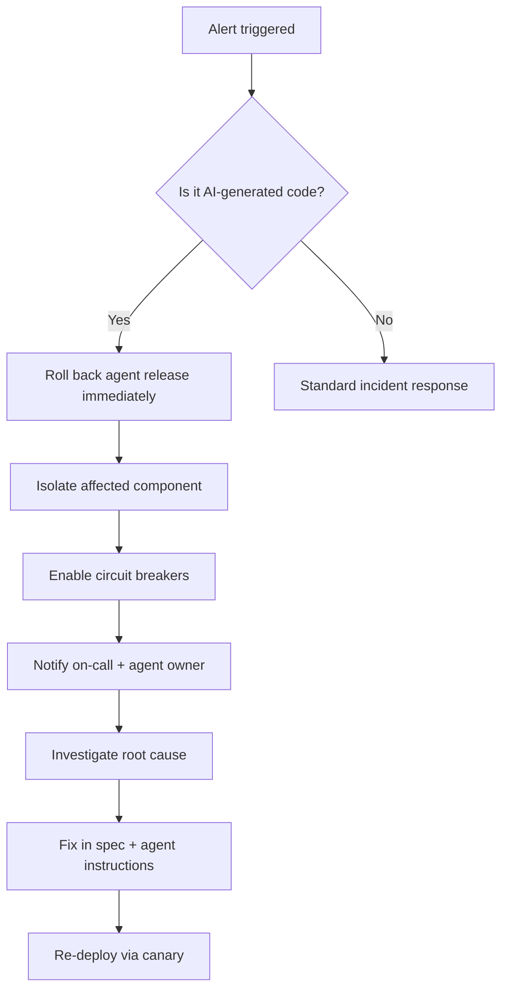

# 🤖 42 - AIOps for AI-Generated Workloads

> **AI-generated code ships fast, but it breaks fast too.** AIOps gives AI-built workloads the self-healing, predictive scaling, and automated incident response they need to survive in production.
> **Operations for AI-generated code is not optional — it is the safety net that makes autonomy viable.**

**Difficulty:** 🔴 Advanced · **Reading time:** ~14 minutes

---

## 📖 Table of Contents

- [Why AIOps Matters for AI-Built Workloads](#-why-aiops-matters-for-ai-built-workloads)
- [Self-Healing Systems](#-self-healing-systems)
- [Predictive Scaling](#-predictive-scaling)
- [Automated Incident Response](#-automated-incident-response)
- [Canary & Rollout Automation](#-canary--rollout-automation)
- [Observability for AI-Generated Code](#-observability-for-ai-generated-code)
- [Cost-Ops: Token & Spend Automation](#-cost-ops-token--spend-automation)
- [Practical Checklist](#-practical-checklist)
- [Key Takeaways](#-key-takeaways)
- [Next Steps](#-next-steps)

---

## 🎯 Why AIOps Matters for AI-Built Workloads

AI-generated code is higher-risk than human-written code: it often lacks tests, has hidden edge cases, and can be deployed without full understanding. Traditional ops assumes code was reviewed and understood. AIOps for AI-generated workloads assumes the opposite — that code may be fragile, and builds automation around that reality.

**Key differences from traditional AIOps:**

| Traditional AIOps | AIOps for AI-Built Workloads |
|-------------------|------------------------------|
| Code reviewed before deploy | Code may be unreviewed; verify at runtime |
| Predictable failure modes | Emergent, agent-specific failure modes |
| Scaling based on traffic | Scaling based on token spend + traffic |
| Rollback is rare | Rollback is expected and automated |
| Human on-call responds | Agent-assisted or autonomous response |

---

## 🩹 Self-Healing Systems

Self-healing means the system detects and recovers from failures without human intervention.

### Automatic restart & circuit breakers

```yaml
# Example: circuit breaker for an AI-generated API
apiVersion: networking.k8s.io/v1
kind: Service
metadata:
  name: ai-generated-api
spec:
  selector:
    app: ai-generated-api
  ports:
  - port: 8080
```

```python
# Circuit breaker pattern in application code
import pybreaker

breaker = pybreaker.CircuitBreaker(fail_max=3, reset_timeout=30)

@breaker
def call_ai_generated_service(payload):
    # This service may be fragile — protect callers
    return requests.post("http://ai-generated-api:8080/process", json=payload)
```

### Self-healing capabilities to implement

| Capability | What it does | When it triggers |
|------------|--------------|------------------|
| **Auto-restart** | Restart failed containers | CrashLoopBackOff, OOMKilled |
| **Circuit breaker** | Stop calling a failing service | Error rate > threshold |
| **Auto-remediation** | Run a fix script on common failures | High memory, deadlock, expired cert |
| **Self-scaling** | Add replicas under load | CPU/memory > 70% |
| **Dead-letter queue** | Capture failed requests for review | Message processing failure |

**Rule:** If a failure pattern repeats twice, automate the response the third time.

---

## 📈 Predictive Scaling

AI-generated workloads have unpredictable resource patterns. Predictive scaling anticipates load before it hits, rather than reacting after.

### Metrics to scale on

| Metric | Why it matters for AI workloads |
|--------|--------------------------------|
| **Request rate** | Standard traffic signal |
| **Error rate** | AI-generated code may spike errors under load |
| **Token spend rate** | Agent sessions burn tokens; cap them |
| **Queue depth** | Async work from agent-generated pipelines |
| **Cold-start frequency** | AI services may initialize slowly |

### HPA with custom metrics

```yaml
apiVersion: autoscaling/v2
kind: HorizontalPodAutoscaler
metadata:
  name: ai-generated-workload
spec:
  scaleTargetRef:
    apiVersion: apps/v1
    kind: Deployment
    name: ai-generated-workload
  minReplicas: 2
  maxReplicas: 20
  metrics:
  - type: Object
    object:
      metric:
        name: token-spend-per-minute
      target:
        type: Value
        value: "1000"
  behavior:
    scaleUp:
      stabilizationWindowSeconds: 30
      policies:
      - type: Pods
        value: 4
        periodSeconds: 15
    scaleDown:
      stabilizationWindowSeconds: 300
```

### Predictive (not just reactive) scaling

- **Schedule-based scaling** — scale up before known traffic spikes (e.g., business hours)
- **ML-based forecasting** — use historical usage to predict tomorrow's load
- **Token-budget-aware scaling** — stop scaling when token spend hits daily budget

---

## 🚨 Automated Incident Response

When AI-generated code fails in production, response must be fast and structured.

### Incident response playbook for AI workloads



### Automated response actions

| Action | Automation tool | Example |
|--------|----------------|---------|
| Rollback | `kubectl rollout undo` | Revert last agent release |
| Circuit breaker | Service mesh (Istio/Linkerd) | Stop traffic to failing pod |
| Alert | PagerDuty, Opsgenie, Slack | Page on-call + agent owner |
| Log capture | ELK, Loki | Pull logs from agent session |
| Ticket creation | Jira, Linear | Auto-create incident ticket |

### Runbook essentials

Every AI-built service needs a runbook that includes:

- **What the service does** (and who owns it)
- **How to roll back** (one command)
- **Common failure modes** (from agent behavior patterns)
- **Who to page** (agent owner, not just infra on-call)
- **Post-incident actions** (update spec, tighten agent guardrails)

---

## 🔄 Canary & Rollout Automation

AI-generated changes should never go to 100% of traffic immediately.

### Canary deployment pipeline

```yaml
# Argo Rollouts example for AI-generated service
apiVersion: argoproj.io/v1alpha1
kind: Rollout
metadata:
  name: ai-generated-service
spec:
  replicas: 5
  strategy:
    canary:
      steps:
      - setWeight: 10       # 10% traffic to new version
      - pause: {duration: 5m} # Watch metrics
      - setWeight: 50       # 50% traffic
      - pause: {duration: 10m}
      - setWeight: 100      # Full rollout
  template:
    spec:
      containers:
      - name: app
        image: ghcr.io/yourusername/ai-app:latest
```

### Automated rollback triggers

| Metric | Threshold | Action |
|--------|-----------|--------|
| Error rate (5xx) | > 1% for 3 min | Rollback |
| Latency p95 | > 2s for 5 min | Rollback |
| Pod restart rate | > 5 in 10 min | Rollback + alert |
| Token spend | > daily budget | Stop agent sessions |

---

## 📊 Observability for AI-Generated Code

Instrument AI-built services at least as thoroughly as human-written code.

### Essential signals

| Signal | Why track it |
|--------|--------------|
| **Code origin** | Tag metrics by human vs AI authorship |
| **Agent session ID** | Correlate issues with specific agent runs |
| **Model used** | Different models have different failure patterns |
| **Token cost per request** | Spot runaway agent behavior |
| **Review status** | Was this code human-reviewed before deploy? |

### Example: tagging AI-generated code

```python
# Middleware to tag requests served by AI-generated code
@app.middleware("http")
async def tag_ai_origin(request, call_next):
    request.state.code_origin = "ai_generated"
    request.state.agent_session = os.getenv("AGENT_SESSION_ID", "unknown")
    response = await call_next(request)
    response.headers["X-Code-Origin"] = "ai_generated"
    return response
```

### Dashboards to build

- **AI vs human code error rates** — compare reliability
- **Token spend over time** — catch budget overruns
- **Rollback frequency** — measure AI release quality
- **Agent session duration** — spot runaway sessions

---

## 💰 Cost-Ops: Token & Spend Automation

AIOps includes cost control. Token-based pricing means every agent session has a dollar value.

### Spend controls

| Control | Implementation |
|---------|---------------|
| **Per-session token cap** | Stop agent at N tokens |
| **Daily budget alert** | Page on-call when budget > 80% |
| **Per-request cost tracking** | Tag each request with token cost |
| **Model routing enforcement** | Route cheap tasks to cheap models |
| **Idle session termination** | Kill agents after N minutes inactive |

### Example: spend alert

```yaml
# Prometheus alert for token spend
groups:
- name: token-spend
  rules:
  - alert: HighTokenSpend
    expr: token_spend_per_hour > 500
    for: 5m
    annotations:
      summary: "AI token spend exceeding budget"
```

---

## ✅ Practical Checklist

- [ ] Auto-restart configured for all AI-built services
- [ ] Circuit breakers protect callers of fragile AI services
- [ ] HPA with custom metrics (including token spend)
- [ ] Canary deployment pipeline with automated rollback
- [ ] Runbook exists for every AI-built service
- [ ] Code origin tagged (human vs AI) in metrics
- [ ] Per-session token caps enforced
- [ ] Daily spend alerts configured
- [ ] Rollback tested in staging
- [ ] Incident response runbook includes agent owner

---

## 🔑 Key Takeaways

- **AI-generated code is fragile by default** — AIOps is the safety net
- **Self-healing** = auto-restart, circuit breakers, auto-remediation
- **Predictive scaling** accounts for token spend, not just traffic
- **Canary + automated rollback** — never deploy AI changes to 100% immediately
- **Tag code origin** — compare AI vs human reliability
- **Cost is an ops metric** — track token spend like CPU/memory

---

## 🚀 Next Steps

- **Read section 43** (Agent-to-Agent Collaboration Patterns) for orchestrating multiple agents
- **Read section 44** (Advanced Compliance Automation) for governance at scale
- **Read section 36** (Kubernetes Deployment) for the deployment foundation AIOps builds on

---

<center>

*Last updated: November 2026*

</center>