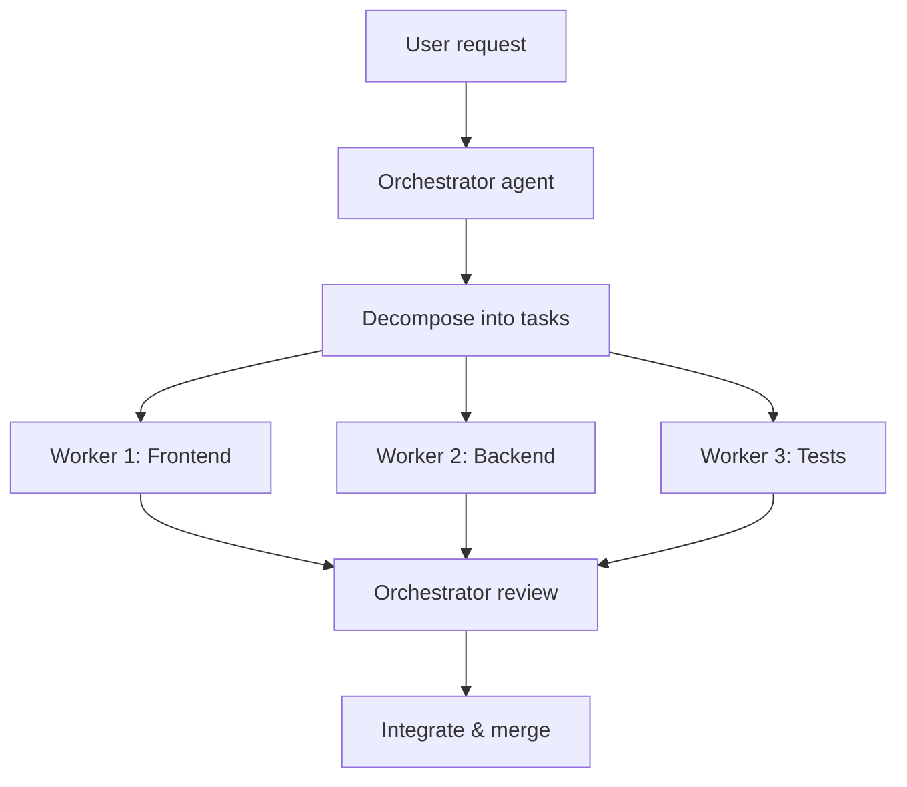
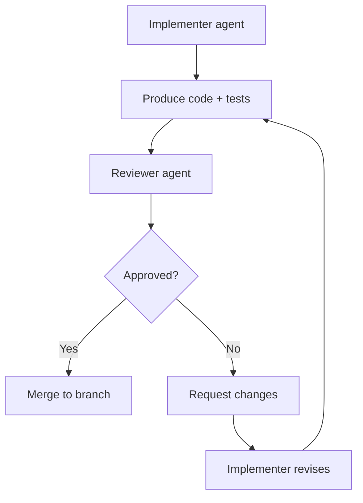
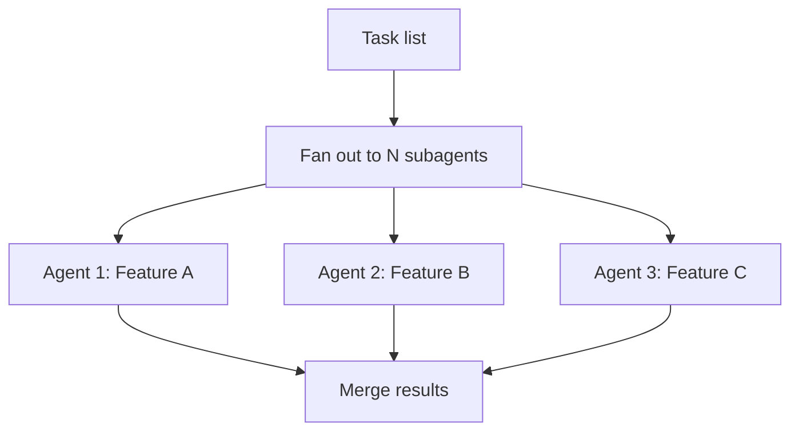

# 🤝 43 - Agent-to-Agent Collaboration Patterns

> **One agent can build a feature. Multiple agents can build a system — if they collaborate without stepping on each other.** This section covers patterns for orchestrating agent teams: orchestrator–worker, reviewer–implementer, parallel subagents, and conflict resolution.
> **Collaboration is the multiplier. Coordination is the guardrail.**

**Difficulty:** 🔴 Advanced · **Reading time:** ~14 minutes

---

## 📖 Table of Contents

- [Why Multi-Agent Collaboration](#-why-multi-agent-collaboration)
- [Orchestrator–Worker Pattern](#-orchestrator-worker-pattern)
- [Reviewer–Implementer Pattern](#-reviewer-implementer-pattern)
- [Parallel Subagents Pattern](#-parallel-subagents-pattern)
- [Debate & Consensus Pattern](#-debate--consensus-pattern)
- [Handoff & Context Transfer](#-handoff--context-transfer)
- [Conflict Resolution](#-conflict-resolution)
- [Shared Memory & State](#-shared-memory--state)
- [Practical Checklist](#-practical-checklist)
- [Key Takeaways](#-key-takeaways)
- [Next Steps](#-next-steps)

---

## 🎯 Why Multi-Agent Collaboration

A single agent has limits: context window, reasoning depth, attention span. Splitting work among specialized agents can handle larger tasks, but introduces new risks: conflicting edits, context drift, duplicated work, and circular dependencies.

**The goal:** more capability, not more chaos. Every multi-agent pattern needs a coordination mechanism.

---

## 🎻 Orchestrator–Worker Pattern

One agent (orchestrator) plans the work, decomposes it, and delegates to specialist agents (workers). The orchestrator reviews results and integrates them.

### When to use

- Complex, multi-step tasks (migration, refactor, new feature)
- Work requiring different expertise (frontend, backend, infra)
- Tasks where decomposition helps quality

### How it works



### Implementation notes

- **Orchestrator owns the plan** — workers execute, don't deviate
- **Workers report status** — complete, blocked, or needs clarification
- **Orchestrator integrates** — resolves merge conflicts, runs full test suite
- **Timeout guards** — if a worker stalls, orchestrator reassigns or escalates

### Example task decomposition

```
Task: Add user settings page
├─ Worker A (Frontend): Settings form component + validation
├─ Worker B (Backend): Settings API endpoint + database schema
├─ Worker C (Tests): Unit + integration tests
└─ Orchestrator: Review all, integrate, deploy
```

---

## 🔄 Reviewer–Implementer Pattern

One agent implements; another reviews. The reviewer can reject, request changes, or approve. This mirrors human PR review but at agent speed.

### When to use

- Security-sensitive code
- Complex logic where bugs are costly
- When you want a "second opinion" before merging

### How it works



### Reviewer checklist (agent-readable)

- [ ] Tests cover new functionality
- [ ] No secrets or credentials in code
- [ ] Error handling present
- [ ] Performance implications considered
- [ ] Matches project style (AGENTS.md)

---

## ⚡ Parallel Subagents Pattern

Multiple independent agents work on separate, non-overlapping tasks simultaneously. Best for fan-out work where tasks don't share state.

### When to use

- Independent features or bug fixes
- Code generation across many files
- Test generation for existing codebase
- Documentation writing

### When NOT to use

- Tasks that edit the same files (conflicts)
- Tasks requiring shared context (drift risk)
- Sequential dependencies (one task blocks another)

### Implementation



### Safety rules

- **Each agent on its own branch** — no shared working directory
- **No shared state** — agents don't read each other's uncommitted changes
- **Merge gate** — human or orchestrator reviews all PRs before merge
- **Conflict detection** — CI detects overlapping file edits

---

## 🗣️ Debate & Consensus Pattern

Multiple agents discuss a design decision, present arguments, and converge on a recommendation. A human (or meta-agent) makes the final call.

### When to use

- Architecture decisions (database choice, framework, API style)
- Security trade-offs
- Performance optimizations with competing approaches

### How it works

```
Round 1: Each agent proposes an approach + rationale
Round 2: Agents critique each other's proposals
Round 3: Agents revise or concede
Round 4: Consensus recommendation + human decision
```

### Example debate topic

"Should we use PostgreSQL or MongoDB for the settings service?"

- Agent A (PostgreSQL): "Structured data, ACID, better for relational settings"
- Agent B (MongoDB): "Flexible schema, faster prototyping, easier scaling"
- Round 2 critiques: A notes MongoDB's lack of transactions; B notes PostgreSQL's rigidity
- Human decides based on team expertise and operational constraints

---

## 🤝 Handoff & Context Transfer

When one agent finishes and another starts, context must transfer cleanly. Without handoff, the second agent repeats work or introduces inconsistencies.

### Handoff artifact

```
# Handoff from Agent A to Agent B

## Task completed
- Implemented user authentication (JWT, httpOnly cookies)

## Files changed
- src/auth/middleware.ts
- src/auth/routes.ts
- src/auth/passport.ts

## Tests
- src/auth/middleware.test.ts (passing)
- src/auth/routes.test.ts (passing)

## Known issues
- Token refresh edge case not handled (see TODO in middleware.ts)

## Next steps
- Implement password reset flow
- Add rate limiting to auth endpoints

## Context for continuation
- Database schema: users table in migrations/001.sql
- Environment: AUTH_SECRET must be set
- AGENTS.md: see authentication section
```

### Handoff rules

- **Never handoff verbally** — write it down in a handoff doc or PR comment
- **Include known issues** — don't hide problems from the next agent
- **Include context** — file paths, env vars, test status
- **Include next steps** — what the next agent should do first

---

## ⚔️ Conflict Resolution

Multi-agent work creates conflicts: overlapping edits, contradictory decisions, duplicate work.

### Types of conflict

| Type | Example | Resolution |
|------|---------|------------|
| **Edit conflict** | Two agents edit same file | Git merge; human or orchestrator resolves |
| **Decision conflict** | Agent A chooses PostgreSQL, Agent B chooses MongoDB | Debate pattern; human decides |
| **Duplicate work** | Two agents build the same feature | Orchestrator detects; keeps one, removes other |
| **Context drift** | Agent B works on outdated assumptions | Handoff doc; re-sync context |

### Prevention

- **Branch per agent** — isolate work until merge
- **File ownership** — assign files to agents; no overlapping ownership
- **Daily sync** — agents (or orchestrator) sync progress daily
- **CI conflict detection** — block merge if files overlap

---

## 🧠 Shared Memory & State

Agents need a shared source of truth to avoid drift.

### Shared memory options

| Option | Best for | Trade-off |
|--------|----------|-----------|
| **AGENTS.md / CLAUDE.md** | Project-wide instructions | Static; doesn't capture runtime state |
| **Shared knowledge base** | Long-term project memory | Requires maintenance |
| **Blackboard pattern** | Active collaboration | Complex to implement |
| **Database/state store** | Runtime state | Infrastructure overhead |

### Blackboard pattern example

```
Blackboard (shared state):
├─ Current sprint goals
├─ In-progress tasks & owners
├─ Completed work & links
├─ Blocked items & reasons
└─ Decisions made & rationale
```

Agents read from and write to the blackboard before and after each task.

---

## ✅ Practical Checklist

- [ ] Orchestrator agent defined for multi-agent tasks
- [ ] Each agent works on its own branch
- [ ] Reviewer–implementer pattern used for security-sensitive code
- [ ] Parallel subagents only for independent, non-overlapping tasks
- [ ] Handoff documents written between agent transitions
- [ ] Conflict detection in CI (overlapping file edits blocked)
- [ ] Shared memory (AGENTS.md, blackboard) maintained
- [ ] Debate pattern used for architecture decisions
- [ ] Human in the loop for final merge decisions
- [ ] Agent audit log tracks who did what and when

---

## 🔑 Key Takeaways

- **One agent builds; multiple agents collaborate** — but coordination is the hard part
- **Orchestrator–worker** for complex decomposition; **reviewer–implementer** for quality; **parallel subagents** for fan-out
- **Never let agents edit the same files simultaneously** — branch per agent
- **Handoff docs prevent context drift** — write them down
- **Conflict detection in CI** catches overlaps before they become merge disasters
- **Human makes final decisions** — agents propose, humans dispose

---

## 🚀 Next Steps

- **Read section 44** (Advanced Compliance Automation) for governance at scale
- **Read section 42** (AIOps for AI-Generated Workloads) for operating multi-agent systems
- **Read section 41** (Ecosystem Integrations) for MCP servers that power agent collaboration

---

<center>

*Last updated: November 2026*

</center>