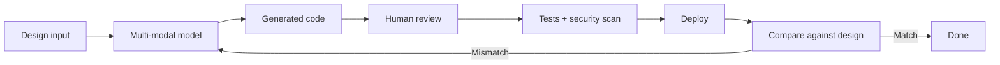

# 🎨 45 - Multi-Modal Vibe Coding

> **Code doesn't always start with text.** Multi-modal vibe coding lets you design with images, mockups, screenshots, and Figma files — then have AI convert them directly into working code.
> **From pixels to production: describe less, show more.**

**Difficulty:** 🟡 Intermediate · **Reading time:** ~12 minutes

---

## 📖 Table of Contents

- [What Is Multi-Modal Vibe Coding](#-what-is-multi-modal-vibe-coding)
- [The Multi-Modal Workflow](#-the-multi-modal-workflow)
- [Image → Code: UI From Mockups](#-image-to-code-ui-from-mockups)
- [Design File → Code: Figma to Components](#-design-file-to-code-figma-to-components)
- [Screenshot → Code: Cloning & Reverse Engineering](#-screenshot-to-code-cloning--reverse-engineering)
- [Sketch → Code: Hand-Drawn to Digital](#-sketch-to-code-hand-drawn-to-digital)
- [Video & Screen Recording → Code](#-video--screen-recording-to-code)
- [Multi-Modal Safety & Review](#-multi-modal-safety--review)
- [Practical Checklist](#-practical-checklist)
- [Key Takeaways](#-key-takeaways)
- [Next Steps](#-next-steps)

---

## 🎯 What Is Multi-Modal Vibe Coding

Multi-modal vibe coding uses AI models that understand both images and text. Instead of describing a UI in words, you show the model a screenshot, Figma file, or hand-drawn sketch, and it generates the corresponding code.

**The progression:**
- **Text → Code:** "Create a login page with email and password fields"
- **Image → Code:** Upload a mockup → generate React components
- **Design → Code:** Figma file → production-ready Tailwind + TypeScript
- **Video → Code:** Screen recording → interactive prototype

---

## 🔄 The Multi-Modal Workflow

**Key stages:**
1. **Design input** — image, mockup, sketch, or design file
2. **Model generation** — multi-modal model produces code
3. **Human review** — verify the code matches the design intent
4. **Tests + security** — standard quality gates (never skip)
5. **Deploy** — ship when verified
6. **Visual comparison** — check rendered output against original design

---

## 🖼️ Image → Code: UI From Mockups

### What works well

- Static UI layouts (landing pages, dashboards, forms)
- Component libraries (buttons, cards, modals)
- Design system implementation
- Responsive breakpoints

### What to watch for

- **Text accuracy** — models may misspell or hallucinate copy
- **Interactivity** — images don't show behavior; you must add logic
- **Accessibility** — models often miss ARIA labels, keyboard navigation
- **Responsiveness** — single image doesn't capture mobile/tablet/desktop

### Example workflow

1. Upload a landing page mockup (PNG/JPG)
2. Prompt: "Convert this to React + Tailwind components. Include accessibility labels and responsive breakpoints."
3. Review generated code against the image
4. Add interactivity (form handlers, navigation)
5. Test on multiple screen sizes

---

## 📐 Design File → Code: Figma to Components

Figma files are the richest design input — they contain layers, auto-layout, typography, colors, and spacing tokens.

### Figma-to-code workflow

1. **Export frames** from Figma as images, or use a Figma MCP plugin
2. **Prompt the model** with the image + design context:
   - "This is a Figma design for a user profile page. Generate Next.js + Tailwind components using the design system tokens."
   - "Match the exact spacing, typography, and colors from the design."
3. **Create a design system** — extract colors, spacing, typography into Tailwind config or CSS variables
4. **Build components** — one component per Figma frame/component
5. **Verify** — use visual diff tools to compare rendered output with Figma

### Figma-specific considerations

- **Auto-layout** → CSS Flexbox/Grid
- **Components** → React/Vue components
- **Variants** → component props (size, color, state)
- **Constraints** → responsive behavior

### Tools to consider

- **Figma MCP servers** — read Figma files directly via Model Context Protocol
- **v0 by Vercel** — image-to-UI generation
- **Cursor + image upload** — paste Figma screenshots directly into chat

---

## 📸 Screenshot → Code: Cloning & Reverse Engineering

Screenshots let you reproduce existing UIs quickly.

### Legitimate uses

- Rebuilding your own legacy UI with modern stack
- Learning from public design patterns
- Creating internal admin tools that match existing products
- Prototyping with stakeholder-provided screenshots

### ⚠️ Legal & ethical boundaries

- **Don't clone copyrighted designs** you don't own or have rights to
- **Don't scrape competitor UIs** to replicate their product
- **Respect trademarks** — logos, brand colors, distinctive trade dress
- **When in doubt, ask** — get permission before reproducing someone else's UI

### Workflow

1. Take screenshot of target UI
2. Prompt: "Recreate this layout in HTML + CSS. Focus on structure and styling, not functionality."
3. Replace placeholder content with your own
4. Add your own functionality and branding

---

## ✏️ Sketch → Code: Hand-Drawn to Digital

Hand-drawn sketches are the fastest way to capture ideas. Multi-modal models can interpret them.

### Best practices

- **Draw clearly** — use dark pen on white paper, good lighting
- **Label elements** — write "login button," "user avatar," etc. on the sketch
- **Indicate layout** — show which elements are side-by-side vs stacked
- **Note interactions** — write "click opens modal," "submit sends form"

### Workflow

1. Sketch the UI on paper or whiteboard
2. Photo with good lighting
3. Upload + prompt: "Convert this hand-drawn sketch to React components. Label elements as I wrote them."
4. Refine generated code — sketches are imprecise; you'll need to clean up

---

## 🎥 Video & Screen Recording → Code

Video captures behavior, not just appearance — interactions, animations, transitions.

### What video adds

- **Motion** — hover states, transitions, animations
- **Flow** — multi-step user journeys
- **Behavior** — what happens when you click, scroll, submit

### Limitations

- **Much harder for models** — video understanding is less mature than image understanding
- **Longer processing** — videos take more tokens and time
- **Temporal ambiguity** — models may misinterpret timing and sequence

### Workflow

1. Record a short screen capture (10–30 seconds) of desired behavior
2. Upload + prompt: "This video shows a checkout flow. Generate the React components and interaction logic."
3. Implement step by step — don't try to generate everything from one video
4. Test each interaction against the video

---

## 🛡️ Multi-Modal Safety & Review

Multi-modal inputs introduce new risks:

| Risk | Mitigation |
|------|-----------|
| **Copyright infringement** | Only use designs you own or have rights to |
| **Private data in images** | Screenshots may contain PII, credentials, internal info |
| **Missing accessibility** | Models skip ARIA, keyboard nav, color contrast |
| **Visual hallucination** | Models invent details not in the image |
| **Security gaps** | Generated code may lack auth, validation, sanitization |

### Review checklist for multi-modal output

- [ ] Compare rendered code against original design — visual match?
- [ ] No PII or credentials in screenshots before uploading
- [ ] Accessibility audit — ARIA labels, keyboard nav, color contrast
- [ ] Security review — auth, input validation, no secrets
- [ ] Responsive check — mobile, tablet, desktop
- [ ] Performance — generated code isn't bloated with unused styles

### Tools for visual verification

- **Visual diff** — Percy, Chromatic, Storybook (compare rendered output to design)
- **Accessibility** — axe-core, Lighthouse, WAVE
- **Responsive testing** — browser dev tools, BrowserStack

---

## ✅ Practical Checklist

- [ ] Use only designs you own or have rights to
- [ ] Strip PII/credentials from screenshots before uploading
- [ ] Prompt for accessibility (ARIA, keyboard nav, contrast)
- [ ] Review generated code against original design visually
- [ ] Add interactivity that images can't show
- [ ] Test responsive breakpoints
- [ ] Run security scan on generated code
- [ ] Add tests for component behavior
- [ ] Document design-to-code decisions in AGENTS.md

---

## 🔑 Key Takeaways

- **Show, don't just tell** — images and design files communicate UI intent better than text
- **Multi-modal models bridge design and code** — Figma, screenshots, sketches all work
- **Images don't show behavior** — you must add interactivity, logic, and accessibility
- **Legal boundaries matter** — don't clone copyrighted designs; strip PII from screenshots
- **Review visually** — generated code must match the design, not just "look close"
- **Standard quality gates still apply** — tests, security scan, accessibility audit

---

## 🚀 Next Steps

- **Read section 44** (Advanced Compliance Automation) for compliance in design-to-code workflows
- **Read section 41** (Ecosystem Integrations) for Figma MCP servers and design-system tooling
- **Read section 35** (Starter Kits) for design-system-ready starter templates

---

*Last updated: November 2026*

